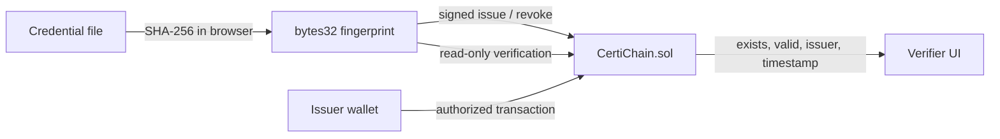

# CertiChain

### A privacy-aware credential registry with an on-chain audit trail.

CertiChain is an EVM prototype for issuing and checking digital credential fingerprints. Issuers register a SHA-256 digest on-chain; verifiers hash a supplied file locally and query the registry. The document and personal information stay off-chain.

> **Status:** local prototype. No public deployment, production users, or security audit is claimed. The transcript in the report is illustrative; capture your own local-chain evidence before presenting a live deployment.

## Product walkthrough

- Connect an injected EVM wallet and see the active network.
- Hash a credential file in the browser. The file is never uploaded by this interface.
- Check whether its fingerprint exists and whether the record is valid or revoked.
- Issue a fingerprint from an authorized issuer wallet; revoke from the issuer or registry owner.
- Save a registry address in this browser. The wallet handles transaction signing.

Issuer permissions are administered by the contract owner through `setIssuerAuthorization` in Remix or another contract console. The UI does not expose a public admin panel.

## Architecture



**On-chain:** fingerprint, issuer address, issuance timestamp, revocation state, and issuer authorization.  
**Off-chain:** credential file, recipient identity, event details, and personal information.

Ethereum mainnet uses proof-of-stake validators to agree on canonical blocks and state. Remix VM and Ganache are development environments for executing EVM transactions; they do not demonstrate mainnet validator consensus.

## Project structure

```text
CertiChain/
├── app/
│   ├── index.html       # Wallet-connected browser interface
│   ├── app.js           # File hashing and contract interactions (ethers v6)
│   └── styles.css       # Responsive UI
├── contracts/
│   └── CertiChain.sol   # Issuer-gated credential registry
├── scripts/
│   └── hash_certificate.py
├── docs/
│   └── Project_Report.pdf
└── build_report.py
```

## Run locally

### Deploy the contract

1. Open [Remix IDE](https://remix.ethereum.org/).
2. Create a file from `contracts/CertiChain.sol` and compile with Solidity `0.8.24` or a compatible `0.8.x` compiler.
3. Select **Remix VM** in Deploy & Run, then deploy. The deploying account is the owner and initial authorized issuer.
4. Copy the deployed contract address. For a persistent development chain, use Ganache and connect Remix to its RPC provider.

### Launch the interface

From the repository root:

```bash
cd app
python -m http.server 8000
```

Open `http://localhost:8000`, connect the wallet to the deployment network, then save the contract address under **Developer Configuration**. The interface loads ethers.js 6.17.0 from jsDelivr; an internet connection is needed for the library and optional web fonts.

### Demonstrate the flow

1. Create a non-sensitive sample file and choose it in **Check a credential**.
2. Verify before issuance; the interface should report no record.
3. As the deployer or an authorized issuer, issue the fingerprint and confirm the transaction in the wallet.
4. Verify the same file again; the result shows its status, issuer, and issue time.
5. Revoke the record as the issuer or owner, then verify again.
6. Connect an unauthorized wallet and confirm issuance is unavailable or rejected by the contract.

The optional CLI helper prints a 32-byte SHA-256 fingerprint:

```powershell
python scripts/hash_certificate.py path\to\sample-certificate.txt
```

## Contract surface

| Method | Access | Behavior |
|---|---|---|
| `setIssuerAuthorization(address,bool)` | Owner | Grant or remove issuer permission |
| `issueCertificate(bytes32)` | Authorized issuer | Record a unique fingerprint and emit `CertificateIssued` |
| `revokeCertificate(bytes32)` | Issuer or owner | Revoke an existing record and emit `CertificateRevoked` |
| `verifyCertificate(bytes32)` | Public read | Return existence, validity, issuer, and issue timestamp |

Revocation preserves the original record and event history. Duplicate issuance and unknown-record revocation revert.

## Security and privacy

- Never write certificate files, names, student IDs, or sensitive metadata to a public chain.
- A digest match proves file equality relative to a registered fingerprint; it does not prove the issuer's claim is true.
- File canonicalization matters: metadata or encoding changes produce a different digest.
- The owner is a governance trust point and can authorize issuers or revoke any record. A compromised owner key can undermine issuer controls.
- This prototype has not been audited. Do not use it for consequential credentials without a threat model, key-management plan, independent review, and privacy/legal review.
- Do not put a private key or seed phrase in the app or repository. Wallet transactions are signed by the injected wallet.

## Limitations and next steps

- No public/testnet contract address or explorer transaction is configured. Supply the address after deploying locally.
- The wallet must be connected to the same network where the contract is deployed.
- A production rollout should add multi-signature administration, issuer-key rotation, standardized credential canonicalization, independent contract audits, and deployment verification.
- Add real screenshots and verified deployment metadata only after those steps are complete.

## Portfolio materials

- [Technical project report](docs/Project_Report.pdf)
- [Smart contract source](contracts/CertiChain.sol)
- [Browser interface](app/index.html)

