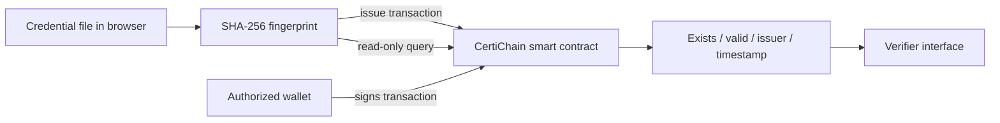
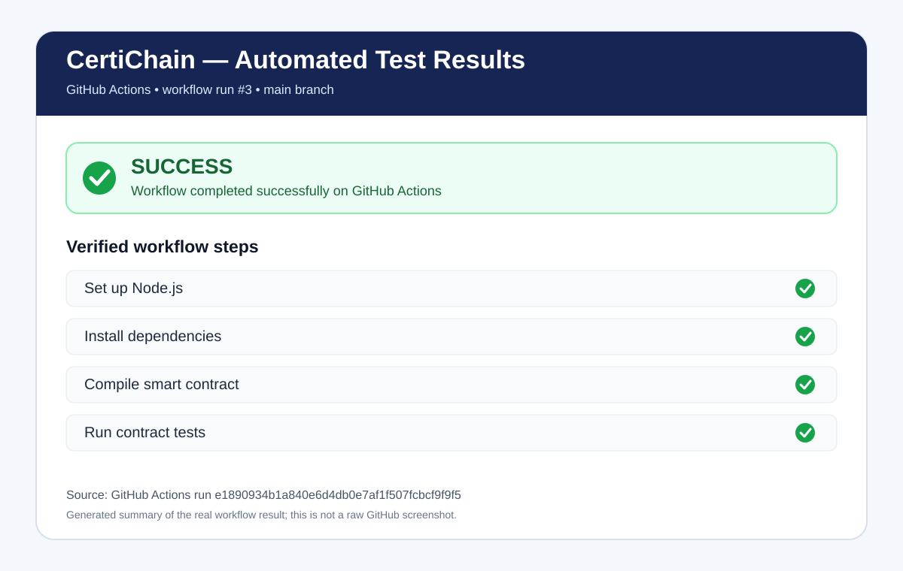

# CertiChain — Blockchain-Based Certificate Verification

**Project type:** Blockchain mini project / EVM DApp prototype  
**Core idea:** Issue, verify, and revoke academic credential fingerprints while keeping certificate files and personal information off-chain.

## 1. Introduction
CertiChain demonstrates how a smart contract and cryptographic hashing can support integrity checks for digital certificates. A browser calculates a SHA-256 digest of a selected file. The contract stores the digest with issuer and status metadata; a verifier calculates the digest again and queries the registry.

## 2. Problem Statement
Manual certificate verification can be slow and can depend on contacting the issuing institution. A document that has been changed may be difficult to detect if there is no trusted reference fingerprint.

## 3. Objectives
- Register a unique certificate fingerprint through an authorized issuer.
- Verify whether a fingerprint exists and whether its record is valid or revoked.
- Allow the issuer or contract owner to revoke a record without deleting its history.
- Keep certificate files and personal details off-chain.
- Demonstrate wallet-signed transactions, smart-contract access control, and read-only verification.

## 4. Blockchain Platform and Tools
- **Solidity 0.8.x:** smart-contract language.
- **EVM-compatible environment:** executes the contract.
- **Remix IDE:** compile and deploy for the local demonstration.
- **Remix VM or Ganache:** local development chain; this project does not claim a public-mainnet deployment.
- **ethers.js v6:** browser-to-wallet and browser-to-contract interaction.
- **Browser Web Crypto API:** SHA-256 file fingerprinting.
- **GitHub:** source-code and documentation repository.

## 5. System Architecture



**Stored on-chain:** fingerprint, issuer address, issuance timestamp, revocation status, and issuer authorization.  
**Kept off-chain:** original document, recipient identity, student ID, and personal information.

Ethereum mainnet uses proof-of-stake validators to agree on canonical chain state. A Remix VM/Ganache demo is a local development environment and does not itself demonstrate mainnet consensus.

## 6. Smart Contract Design
Source: [`contracts/CertiChain.sol`](contracts/CertiChain.sol)

| Function | Access | Purpose |
|---|---|---|
| `setIssuerAuthorization(address,bool)` | Owner only | Authorize or remove an issuer |
| `issueCertificate(bytes32)` | Authorized issuer | Store a unique non-zero fingerprint and emit an event |
| `revokeCertificate(bytes32)` | Original issuer or owner | Mark an existing record revoked; retain record history |
| `verifyCertificate(bytes32)` | Public read | Return existence, validity, issuer, and issue timestamp |

The deployer becomes the owner and the initial authorized issuer. Duplicate issuance, zero fingerprints, unauthorized issuance, unknown-record revocation, and repeated revocation are rejected by contract checks.

## 7. Setup and Execution
1. Open [Remix IDE](https://remix.ethereum.org/).
2. Copy `contracts/CertiChain.sol` into Remix and compile using Solidity 0.8.24 or a compatible 0.8.x compiler.
3. Select **Remix VM** in Deploy & Run and deploy the contract. Save the deployed address.
4. From the repository root, run the interface:
   ```bash
   cd app
   python -m http.server 8000
   ```
5. Open `http://localhost:8000`, connect the injected EVM wallet to the same network used for deployment, and enter/save the contract address in Developer Configuration.
6. Use a non-sensitive sample file for the demo. Verify it before issuing, issue it from the authorized account, verify it again, revoke it, and verify the revoked status.
7. Test issuer authorization with an unauthorized wallet/account.

**Deployment status:** local deployment instructions are provided. No public-chain address, explorer link, or completed live transaction is claimed in this repository.

## 8. Automated Contract Tests
The repository includes a Hardhat configuration and automated tests in `test/CertiChain.test.js`. The suite covers owner setup, issuer authorization, successful issuance and verification, duplicate/zero-hash rejection, unauthorized issuance, revocation, access control, repeated revocation, and unknown-record revocation.

Run from the repository root after installing Node.js:

```bash
npm install
npm run compile
npm test
```

A GitHub Actions workflow at `.github/workflows/contract-tests.yml` is configured to compile the contract and run tests on pushes, pull requests, or manual workflow dispatch. Check the **Actions** tab for the actual run result; adding the workflow does not itself mean a run has passed.

## 9. Test Plan and Expected Results
Run these tests yourself on the local chain and record the actual result and transaction details. These are expected outcomes, not a claim that they have already been executed.

| Test | Action | Expected result |
|---|---|---|
| Unknown fingerprint | Verify before issuance | No registered record |
| Issue fingerprint | Authorized issuer calls issue | Transaction succeeds; event emitted |
| Verify issued record | Query the same fingerprint | Exists = true; valid = true |
| Duplicate issuance | Issue the same fingerprint again | Transaction reverts |
| Revoke record | Issuer or owner revokes it | Transaction succeeds; event emitted |
| Verify revoked record | Query after revocation | Exists = true; valid = false |
| Unauthorized issuance | Unapproved account issues | Transaction reverts |
| Privacy check | Inspect app flow | File is hashed in browser, not uploaded by this interface |

## 10. Screenshots and Outputs

### Automated test output
The GitHub Actions run completed successfully: Node.js setup, dependency installation, contract compilation, and automated tests all reported success. See the [actual workflow run](https://github.com/SwapnilPatil-1993/certichain-credential-registry/actions/runs/38369418741) and the [test-result summary image](docs/screenshots/ci-test-summary.svg).



The SVG is a summary graphic based on the real workflow result; it is not a raw screenshot of the GitHub UI.

### Local contract demo screenshots — still to capture
Add genuine screenshots to `docs/screenshots/` after executing the steps above:
1. `01-remix-compile.png` — successful contract compilation.
2. `02-contract-deployed.png` — deployed contract and address in Remix.
3. `03-issue-transaction.png` — successful issue transaction.
4. `04-verify-valid.png` — verification of an issued credential.
5. `05-revoke-transaction.png` — successful revoke transaction.
6. `06-verify-revoked.png` — verification after revocation.
7. `07-unauthorized-test.png` — rejected unauthorized action, if captured.

Do not use mock images as evidence of execution. Add the local contract address, network name, and transaction hashes to the report only after confirming them in your own run.

## 11. Conclusion
CertiChain is an educational prototype showing how smart contracts, wallet authorization, hashing, and blockchain records can support certificate fingerprint verification. It demonstrates a practical DApp workflow while keeping the certificate itself off-chain.

## 12. Future Scope
Possible improvements include multi-signature ownership, issuer key rotation, standardized document canonicalization, automated contract tests, independent security review, and a carefully reviewed testnet deployment.

## Security and Privacy Notes
A hash match confirms that the file matches a registered fingerprint; it does not independently prove the certificate issuer's claim is truthful. Do not store student names, IDs, certificate files, private keys, or seed phrases on-chain or in this repository. This prototype has not been independently audited and is not intended for consequential production use.

## Repository Contents
- [Smart contract](contracts/CertiChain.sol)
- [Browser app](app/index.html)
- [Existing project report](docs/Project_Report.pdf)

**Repository:** https://github.com/SwapnilPatil-1993/certichain-credential-registry
